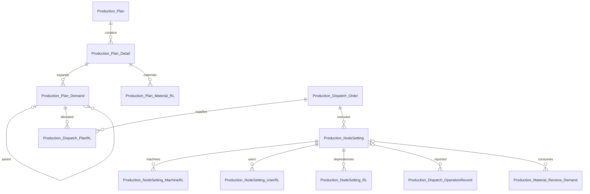

# 生产计划与工序派工结构补充

2026-10-21。按当前源码及用户补充的 `Production_NodeSetting`、`Production_NodeSetting_MachineRL` 定义整理。本次只生成实体、映射和隔离验证；未连接或修改数据库，未生成或执行宿主 EF 迁移，未接通前端及业务 Controller。

## 现有结构与缺口

| 功能 | 原有结构 | 本次处理 |
| --- | --- | --- |
| 按产品/规格派工、数量和单位 | Production_Dispatch_Order | 复用，不另建排产主表 |
| 多销售订单分配 | Production_Dispatch_SaleRL | 保留，不能代替生产计划需求分配 |
| 生产计划、多成品 | 本目录缺少 | 新增 Production_Plan、Production_Plan_Detail |
| 各成品逐工序物料采购与入库跟踪 | 用户提供 ProductionPlan_Material_RL 参考 | 新增 Production_Plan_Material_RL，归属成品明细 |
| 多层需求与来源路径 | 本目录缺少持久化结构 | 新增 Production_Plan_Demand |
| 同一派工单满足多个计划需求 | 本目录缺少 | 新增 Production_Dispatch_PlanRL |
| 实际工序、设备分配 | 用户补充了宿主实体 | 按用户原定义落盘，仅扩展排产字段 |
| 多前置工序关系 | 本目录缺少 | 新增 Production_NodeSetting_RL |
| 工序人员分配 | 本目录缺少 | 新增 Production_NodeSetting_UserRL |
| 报工归属工序、设备 | 原报工只关联派工单 | OperationRecord 增加可空 NodeSettingId、NodeSettingMachineId |
| 工序领料 | 已有 Material_Receive_Demand.NodeSettingId | 保留，改用复合外键限制同一派工单 |
| 设备领料 | 已有 Machine_Material_Receive_Demand | 复用原有结构 |

共新增 **7 张表对应的实体**，补全并扩展用户提供的 **2 个宿主实体**，修改 **2 个现有实体映射/字段**。新增枚举为 ProductionPlanStatus，以及沿用用户参考数值的 ProductionPlanType（备货计划=1、销售订单=2）；NodeType、NodeState 沿用宿主定义，本次不猜测其成员或数值。

所有实体位于 `backend/Production/KingZon.OLCM.Production.DataBase/Entities`。本次新增映射与实体放在同一文件，沿用 KingZonEntityTypeConfiguration。具体文件：

- `Production_Plan.cs`：计划编号、日期、状态及成品明细集合。
- `Production_Plan_Detail.cs`：成品/规格、工艺版本、计划数量、计量单位与快照、当前需求版本；不保存来源、日期或进度汇总。
- `Production_Plan_Material_RL.cs`：每条成品明细的工序物料、需求/采购/入库/退货/退货出库数量及完成状态。
- `Production_Plan_Demand.cs`：父子需求节点、路径键、物料身份、生产工艺版本、全部来源工序和物料行、毛需求与待生产量、交期。
- `Production_Dispatch_PlanRL.cs`：派工单到需求节点的数量分配及入库分配、换算快照。
- `Production_NodeSetting_RL.cs`：同一派工单内工序前后置关系，支持多个前置节点。
- `Production_NodeSetting_UserRL.cs`：工序到人员的数量与时间分配。

## 关系



一张计划包含成品 A、B，各自展开半成品 C 的需求 30、50。两个需求节点保留各自来源，同一个 C 派工单生产 80，在 PlanRL 记录两条 30/50 的分配。相同成品/半成品也必须按规格、工艺版本、单位和交期判断是否可以合单。原材料节点可保留在需求树中，但不能直接作为生产任务下达。

## 单位与来源口径

按用户最新要求，成品明细仅用于列出多个成品：保留 ProductId、SpecificationId、CraftOrderVersionId、ProductionPlanQuantity、UnitId、UnitConversionId、UnitInfo，以及归属、顺序和需求重算的技术字段。移除成品明细上的排产、异常、半成品入库、委外、成品入库汇总字段；这些数量应按实际执行数据查询，不在明细维护另一套进度账。

来源类型 SourceDataType、来源主表 SourceDataId、ProductionPlanTime、RequiredDate、CompleteTime 统一在 Production_Plan 主表；完成状态以主表 Status 为准。不同来源需分别建计划，多选计划进入同一个排产工作台；不再在成品明细上记录多个来源或各自交期。

ProductionPlanQuantity 使用成品明细 UnitId；需求节点 RequiredQuantity、ProductionQuantity 和分配行 Quantity、InboundQuantity 使用该需求节点 UnitId。分配行 DispatchQuantity 使用派工单 DispatchUnit。保存时按快照换算，不能混合不同单位或将多个成品直接合计成计划主表数量。

Production_Plan_Material_RL 对应用户给出的逐工序物料跟踪用途，数量均按本行 UnitId，以 decimal(18,6) 保存。旧 RawMaterialId/MaterialType 改为当前项目 DataId/InventoryDataType，支持产品物料和规格物料，不引用缺少的新旧混合 RawMaterial 实体。PlanDetailId 可经成品明细查到 PlanId，避免重复存两个可发生矛盾的归属字段。CraftOrderVersionId、NodeTemplateSettingId 为来源模板关联，保存时需核对版本归属；不能当成实际 Production_NodeSetting.Id。

逐工序物料跟踪与 Plan_Demand 的多路径需求快照用途不同：前者记录供应进度，后者用于需求展开及排产分配。不能把采购量、入库量、需求快照量重复计作可用库存，也不能因重算快照就清空实际采购/入库进度。本次只定义字段，没有自动同步这些汇总值。当前范围不包含流转卡。

BasisType/BasisId 继续表示配方、BOM 或工艺版本依据；来源计划通过 PlanRL 关联，不能把计划 ID 填入 BasisId。工序物料需求仍来源于工序单输入物料，不改成制造 BOM 展开。

需求 Revision 是不可变的展开版本。重算保留旧节点，PlanDetail.DemandRevision 指向当前版本；旧分配未解除时不能直接删树或覆盖用量。DemandKey 使用完整来源路径的稳定标识（长路径可哈希），不能仅用物料 ID，以免不同路径误合并。

## 保留的宿主字段

工序仍使用 `Order`、`NodeType`、`State`、`NodeName`、`CraftId`、`NodeTemplateSettingId`、`ReciveQuantity`、`CompleteQuantity`、`DoingQuantity`，没有替换为另一套状态或数量字段。

工序扩展了 CraftOrderVersionId、PlanQuantity、计划/实际时间、准备工时、单位加工工时、IsCompletionNode、Revision。来源模板继续使用原字段 NodeTemplateSettingId，下达接口核对其真实宿主模板来源及工艺版本，不另加同义模板 ID。

设备关联保留 DispatchQuantity、ReciveQuantity、CompleteQuantity、DoingQuantity；只新增计划起止时间及供报工关联使用的复合候选键。DoingQuantity 仍为 `MAX(ReciveQuantity - CompleteQuantity, 0)` 对应的原 IF 计算列。未对已有工序顺序或设备关联添加新的唯一索引，避免假定历史记录绝不重复。

## 需要接入的业务逻辑（尚未实现）

1. 在宿主 Production DbContext 中确认程序集自动扫描这些映射；若未自动扫描，则注册映射和 DbSet。工作区没有宿主 DbContext/csproj，不能宣称完成迁移或宿主构建。
2. 批量需求接口接收计划明细集合，校验企业权限、有效计划及工艺版本；同一物料共用一份库存分配池，不能各成品单独扣同一份库存。
3. 计划保存校验成品明细数量大于零、产品规格归属、单位快照有效、主表日期顺序、毛需求/待生产量非负。稳定编号仍按宿主企业隔离规则生成；未建立跨企业单号唯一约束。
4. 下达排产在同一事务生成/复用派工单、需求分配、工序、工序边及设备/人员分配。校验同产品/规格/工艺、来源需求版本、分配总量、设备/人员资格与时间冲突。资源分配不与派工数量重复累计。
5. 同一需求分配时递增 PlanDemand.AllocationRevision；同时校验并更新派工单总分配量，防止两个不同分配行并发超配。ConcurrencyCheck 仅在业务代码实际递增并提交原值时有效，本次没有实现锁定和保存接口。
6. 工序关系保存时检查自引用和环。已有复合外键限制前后工序属于同一派工单；跨派工单的半成品供需关系由需求树和分配关联表达，未实现跨单工序依赖。
7. 报工接口接收 NodeSettingId，设备报工还接收 NodeSettingMachineId；设备 ID 有值时工序 ID 必须有值。核对有效节点和允许数量，更新工序/设备数量；新工序流程只从指定唯一完工结算节点更新派工单总完工量。现有 DispatchOperateController 仍按整单累计，需要改造后才能启用多工序报工。
8. 领料时将来源工序物料映射到实际 NodeSettingId；设备领料核对 MachineId 与 NodeSettingMachineId 一致，不能跨工序/派工单关联。现有接口没有自动生成这些工序归属。
9. 取消需求需解除相应数量分配；需求、分配与执行数据有引用时保留历史，不能级联清除已执行来源。唯一的分配组合取消后重用原行。软删除过滤及企业隔离沿用宿主。
10. 接上多计划页面、工序任务及甘特编辑，再开放保存入口。甘特时间冲突和产能约束仍需业务校验；仅有时间字段不等于已具备自动排程。

## 迁移注意

宿主提供的两个 NodeSetting 表视为已有表，不能再次创建。新增工序扩展、设备起止时间和可空报工关联；原表业务字段保持不变。新增复合候选键和外键前，清查领料中 NodeSettingId 与 DispatchOrderId 的历史归属是否一致。旧记录可保持新增字段为空/零，不自动推断完工结算节点。

工艺版本和来源模板为跨模块逻辑引用，保存接口必须校验存在性和所属关系；没有通过猜测技术程序集名称新增跨模块外键。NodeType/NodeState 的真实声明由宿主提供。不存在宿主迁移上下文时不生成冒充正式迁移的 SQL；也未执行任何数据库变更。

## 验证

```powershell
python backend/Production/tests/verify_production_planning.py
python backend/Production/tests/verify_dispatch_bom.py
```

隔离项目编译实际新增实体及映射、报工和领料实体，外部 Base/派工主表/既有枚举使用明确的测试替身。验证多成品来源分配、来源路径唯一性、跨计划父节点限制、工序前后置与资源、历史无工序报工、工序/设备/收入计算列、跨派工单报工和领料限制、设备报工的工序一致性、需求分配乐观并发及无影子外键。原 BOM/配方派工保存和补料序号检查也通过。上述检查不能替代完整宿主构建、MySQL 迁移和业务联调。
